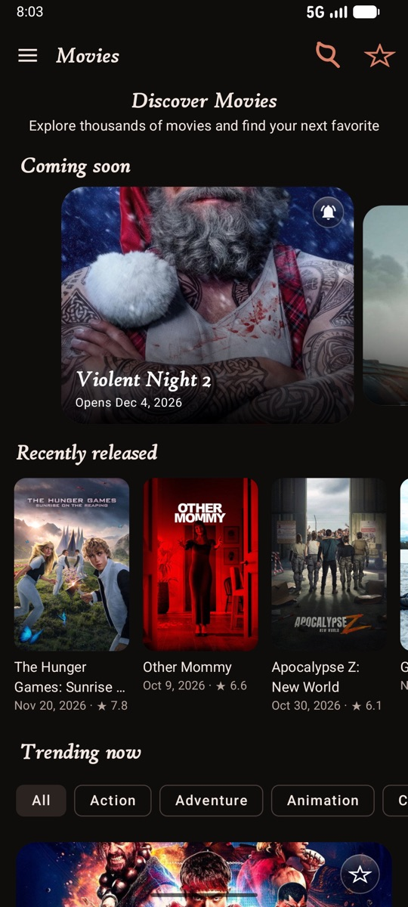
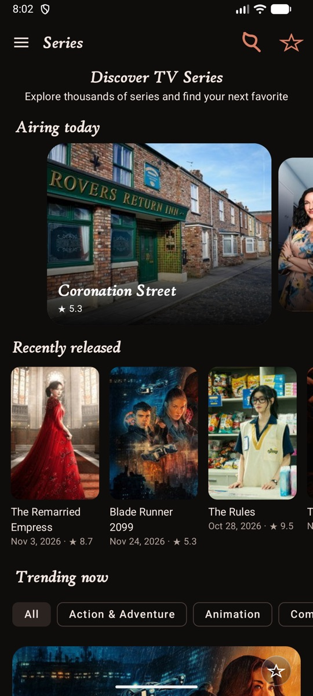
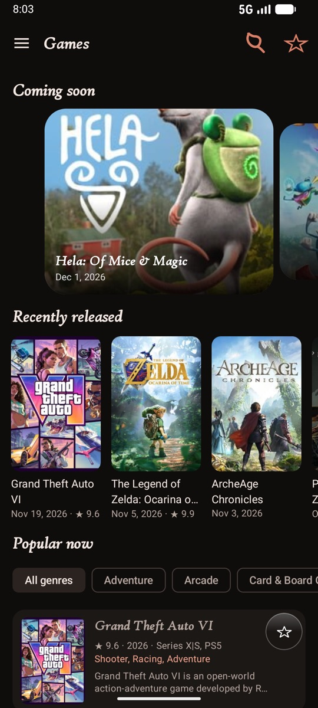
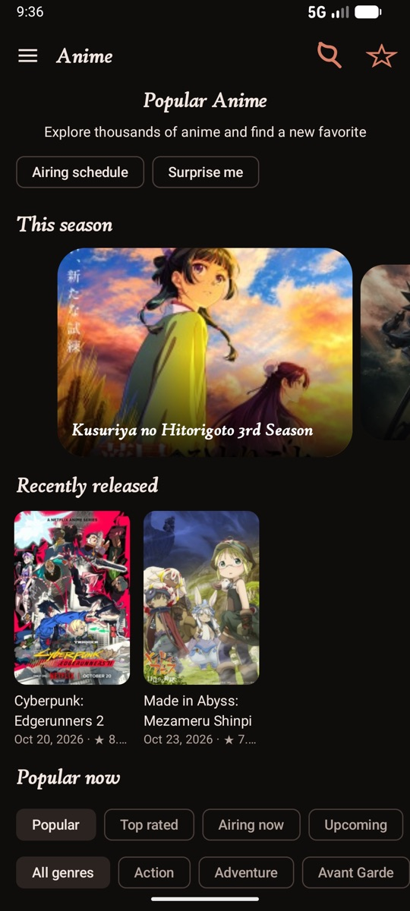
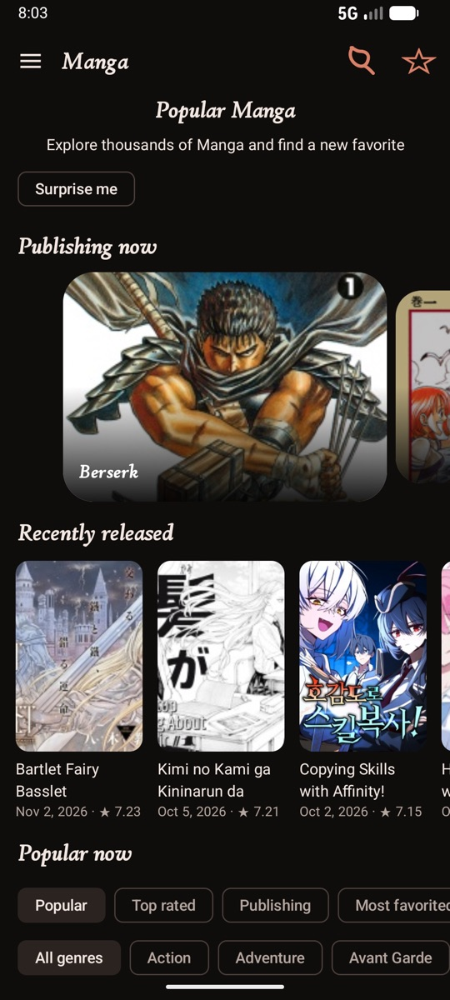

# E-Catalogs

[](https://github.com/rColeJnr/E-Catalog/actions/workflows/build.yml)

**Available on Google Play:** [E-Catalogs on the Play Store](https://play.google.com/store/apps/details?id=com.rick.moviecatalog)

<a href="https://play.google.com/store/apps/details?id=com.rick.moviecatalog"></a>

E-Catalogs is an Android app for discovering movies, TV series, books, anime, manga and video games, built on five
public APIs. It has been in development since 2022 and is published on Google Play.

## What's in the app
| Area | Source | Highlights |
|---|---|---|
| **Movies & TV series** | [TMDB](https://www.themoviedb.org/) | Trending, coming soon, airing today, recently released, genre filters, trailers you watch in the app, cast, where to watch, similar titles, seasons and episodes |
| **Movie reviews** | [New York Times](https://developer.nytimes.com/) | Critics' reviews on their own page, with the full review and a link to the film they review |
| **Books** | [Project Gutenberg](https://gutendex.com/) and NYT Best Sellers | Free books with a built-in reader, best-seller lists by genre, screen adaptations |
| **Anime & manga** | [jikan-edge](https://github.com/LucasHenriqueDiniz/jikan-edge) (MyAnimeList) | This season, recently released, top lists, genres, weekly schedule, trailers, characters and people, relations |
| **Video games** | [IGDB](https://www.igdb.com/) | Popular now, coming soon, recently released, genres, trailers (built entirely in Jetpack Compose) |

In every area: search with recent queries, favorites, and translation of descriptions (Portuguese and Russian).
The app also has:
- **In-app trailers**: YouTube trailers play right in the details screen, in a swipeable gallery with the poster and
  backdrops, or full screen (immersive in landscape, without restarting when the phone turns).
- **Offline-first catalogs**: lists are cached in Room and paged with Paging 3, so they load instantly and work without a connection.
- **Background sync and notifications**: WorkManager refreshes the trending movies and series, movie reviews, best-seller
  lists, games, anime and manga on a schedule you choose and notifies you about new titles, with a switch per category
  in Settings.
- **Accounts**: email, Google and One Tap sign-in (Firebase Auth).
- **Light and dark themes**, in English, Portuguese and Russian.

## Tech stack
- **Language and UI**: Kotlin, XML/ViewBinding screens moving to Jetpack Compose, a shared design system module.
- **Architecture**: Clean Architecture with MVVM, multi-module by feature (data and screen modules per area).
- **Data**: Retrofit (Gson, Kotlinx Serialization), Room with migrations, Paging 3 with RemoteMediator, Proto DataStore.
- **DI and background work**: Hilt, WorkManager.
- **Security**: API keys come from `local.properties` into `BuildConfig` (never committed); the IGDB token is stored
  encrypted with an AES-256-GCM key in the Android Keystore.
- **Media**: in-app YouTube playback with android-youtube-player (YouTube's IFrame player), Coil and Glide sharing one
  disk cache.
- **Build**: Gradle version catalog and convention plugins (`build-logic`), R8, baseline profiles, Firebase Crashlytics.
- **Tests**: unit and Robolectric tests for the data layer, and 84 instrumented UI tests (Espresso, Compose UI Test)
  covering navigation, login, settings, trailers and every catalog flow.
- **CI/CD** (GitHub Actions): every pull request and push to `develop`/`main` runs the unit tests, lint, all build
  variants (release shrunk by R8) and the UI tests on Android emulators (API 26 and 34), with a coverage report. A
  version tag (`v2.3.0`) builds the signed bundle and uploads it to Google Play's internal testing track.

## Getting started
The **demo** flavor uses bundled sample data, so it runs without any API key:
```bash
./gradlew :app:installDemoDebug
```

The **prod** flavor calls the real APIs. Add your own keys to `local.properties` in the project root (git-ignored):
```properties
tmdbApiKey=YOUR_TMDB_KEY               # themoviedb.org/settings/api
nyTimesApiKey=YOUR_NYT_KEY             # developer.nytimes.com (Article Search and Books APIs)
translationApiKey=YOUR_TRANSLATION_KEY # aistudio.yandex.ru
igdbClientId=YOUR_TWITCH_CLIENT_ID     # dev.twitch.tv/console
igdbClientSecret=YOUR_TWITCH_SECRET
```

Run the tests:
```bash
./gradlew testDemoDebugUnitTest                  # unit tests
./gradlew :app:connectedDemoDebugAndroidTest     # UI tests (needs a device or emulator)
```

The same checks run on GitHub Actions for every pull request ([`build.yml`](.github/workflows/build.yml)); releases to
Google Play are described in [`release.yml`](.github/workflows/release.yml).

## Project structure
- `:app`: single activity, navigation drawer, app-wide wiring.
- `:movie`, `:book`, `:anime`, `:game`: one area each, split into `data_*` (model, network, database, data) and
  `screen_*` (one module per screen).
- `:settings`, `:authentication`: settings and sign-in.
- `:data`: shared modules (design system, UI components, trailers, DataStore, sync, notifications, translation, testing).
- `:benchmarks`: baseline profile generation and startup and scrolling benchmarks.
- `build-logic`: Gradle convention plugins.

## Screenshots
Every catalog opens the same way: a featured carousel, a row of recent releases, then the main list with its filters.

| Movies | Series | Games |
|---|---|---|
|  |  |  |

| Anime | Manga |
|---|---|
|  |  |
